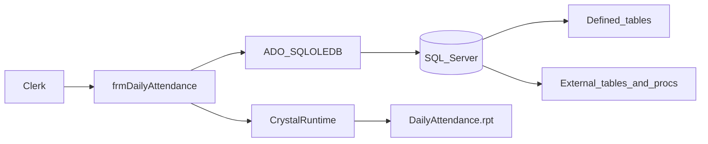
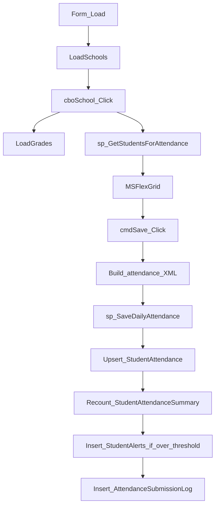
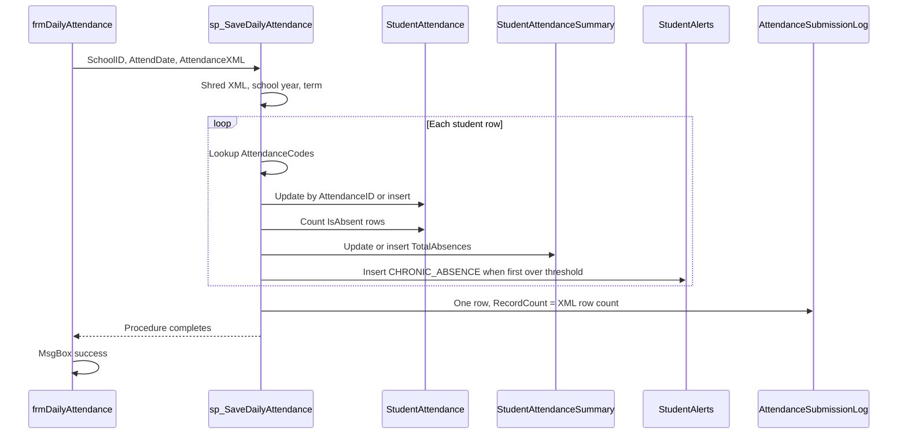
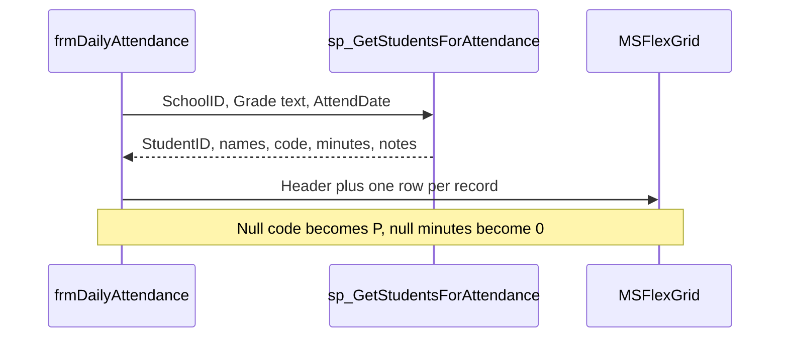
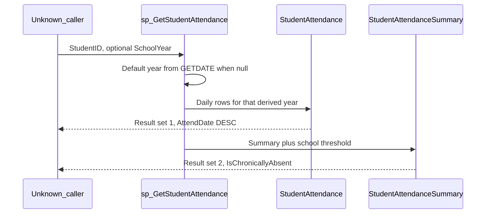

# Legacy Attendance System — Architecture Analysis

Chief-architect analysis of the legacy daily-attendance system. The assessment is based only on the artifacts in `Legacy/`. Objects the code calls but does not define are recorded as external dependencies. Their shape is inferred from call sites and is not treated as implemented schema.

## 1. Scope and artifact inventory

The repository contains a two-tier Windows client and the SQL Server objects that client calls. There is no solution file, no `config.ini`, no Crystal report, and no second form.

| Path | Role |
| --- | --- |
| `Legacy/Forms/frmDailyAttendance.frm` | Visual Basic 6 form: school and grade selection, student grid, save, print |
| `Legacy/Database/schema.sql` | Five tables: students, codes, daily attendance, year summary, alerts |
| `Legacy/Database/sp_SaveDailyAttendance.sql` | Batch upsert of one school-day, plus summary, alert, and submission log |
| `Legacy/Database/sp_GetStudentAttendance.sql` | Student history and year-summary read for one school year |

### Referenced but not defined in this folder

| Dependency | Where it is used | What the call site requires |
| --- | --- | --- |
| `Schools` | `LoadSchools`, save procedure, get procedure | `SchoolID`, `SchoolName`, `Active`, `AbsenceAlertThreshold` |
| `SchoolTerms` | Save procedure, get procedure | `TermID`, `SchoolID`, `StartDate`, `EndDate`, `TermName` |
| `AttendanceSubmissionLog` | End of `sp_SaveDailyAttendance` | `SchoolID`, `SubmittedDate`, `AttendDate`, `RecordCount`, `SubmittedBy` |
| `sp_GetStudentsForAttendance` | `LoadStudents` | Parameters: school id, grade text, attendance date (`yyyy-mm-dd`). Columns read: `StudentID`, `LastName`, `FirstName`, `AttendCode`, `MinutesLate`, `Notes` |
| `SchoolYear()` | Absence recount inside `sp_SaveDailyAttendance` | Scalar function. It is not created in `schema.sql`. The argument passed is the batch date, not each row’s `AttendDate` |
| `App.Path\config.ini` | `Form_Load` connection string | File is concatenated as the OLE DB `Data Source`. It is never opened or parsed |
| `App.Path\Reports\DailyAttendance.rpt` | `cmdPrint_Click` | Crystal report. Selection formula refers to a table named `Attendance`, which is not in the schema |

`frmDailyAttendance` never calls `sp_GetStudentAttendance`. Daily entry and student-year history are separate read paths.

## 2. Platform

The system is a classic two-tier fat client. The form owns screen flow and payload construction. Persistence rules, school-year boundaries, absence totals, and chronic-absence alerts live in T-SQL.

| Layer | Technology | Evidence |
| --- | --- | --- |
| Client UI | Visual Basic 6, Windows desktop | `VERSION 5.00`, `Begin VB.Form`, `.frm`, `App.Path`, `MsgBox` |
| Grid | Microsoft FlexGrid ActiveX | `VB.MSFlexGrid`, `TextMatrix` |
| Data access | ADO 2.x over SQLOLEDB | `ADODB.Connection`, `ADODB.Recordset`, `adOpenStatic`, `adLockOptimistic`, `adStateOpen` |
| Reporting | Crystal Reports COM runtime | `CreateObject("CrystalRuntime.Application")`, `OpenReport`, `PrintOut` |
| Database | Microsoft SQL Server 2008 or later | `DATE`, `NVARCHAR(MAX)`, XML `.nodes()` / `.value()`, `CROSS APPLY` |
| Deployment | Side-by-side with the EXE | Connection and report paths are `App.Path` relative |

SQL Server 2005 is not sufficient: the `DATE` type arrives in SQL Server 2008. XML and `CROSS APPLY` are already available from SQL Server 2005.

There is no middle tier, no ORM, and no application login. `CreatedBy`, `ModifiedBy`, and `SubmittedBy` are SQL `SYSTEM_USER`. The client does not pass a user id.

Naming in the form follows VB6 Hungarian notation: `moConn`, `moRS`, `mlSchoolID`, `mdAttendDate`.

## 3. Architecture



Defined tables: `Students`, `AttendanceCodes`, `StudentAttendance`, `StudentAttendanceSummary`, `StudentAlerts`.

External tables and routines: `Schools`, `SchoolTerms`, `AttendanceSubmissionLog`, `sp_GetStudentsForAttendance`, and the `SchoolYear` function the save procedure calls.



## 4. Database structure

`schema.sql` creates tables only. It does not create primary-key relationships to other tables, foreign keys, indexes beyond the primary keys and one unique constraint, check constraints, or seed data for attendance codes.

### 4.1 `Students`

Master list of students at a school.

| Column | Type | Notes |
| --- | --- | --- |
| `StudentID` | `INT IDENTITY` PK | Surrogate key. The grid sends this value as XML `@sid` |
| `SchoolID` | `INT NOT NULL` | No foreign key to `Schools` |
| `FirstName` | `VARCHAR(100) NOT NULL` | Non-Unicode |
| `LastName` | `VARCHAR(100) NOT NULL` | Non-Unicode |
| `Grade` | `VARCHAR(10) NULL` | Free text. The grade combo loads distinct values |
| `DateOfBirth` | `DATE NULL` | Unused by the attendance form and both procedures |
| `Active` | `BIT NOT NULL DEFAULT 1` | Grade query filters `Active = 1`. The save procedure does not |
| `CreatedDate` | `DATETIME NOT NULL DEFAULT GETDATE()` | Insert timestamp only |

### 4.2 `AttendanceCodes`

Lookup of the short code stored on each attendance row.

| Column | Type | Notes |
| --- | --- | --- |
| `CodeID` | `INT IDENTITY` PK | Unused by the procedures. They match on `CodeValue` |
| `CodeValue` | `VARCHAR(5) NOT NULL UNIQUE` | Examples implied by the form: `P` for present. No codes are seeded |
| `Description` | `VARCHAR(100) NOT NULL` | Returned by the get procedure as `AttendCodeDescription` |
| `IsAbsent` | `BIT NOT NULL DEFAULT 0` | Copied onto `StudentAttendance` at save time |
| `IsExcused` | `BIT NOT NULL DEFAULT 0` | Copied onto `StudentAttendance` at save time |
| `IsActive` | `BIT NOT NULL DEFAULT 1` | Not consulted by the save or get procedure |

`IsAbsent` and `IsExcused` on the attendance row are a snapshot. A later change to the code definition does not rewrite history. The get procedure still inner-joins `AttendanceCodes`, so a deleted or renamed code disappears from history even though the attendance row remains.

### 4.3 `StudentAttendance`

One intended row per student per calendar date. The schema does not enforce that.

| Column | Type | Notes |
| --- | --- | --- |
| `AttendanceID` | `INT IDENTITY` PK | Upsert key once a row is found |
| `StudentID` | `INT NOT NULL` | No foreign key |
| `SchoolID` | `INT NOT NULL` | Set from the batch parameter. Not part of the existence check |
| `AttendDate` | `DATE NOT NULL` | Existence check is `(StudentID, AttendDate)` only |
| `TermID` | `INT NULL` | Resolved once per batch from `SchoolTerms`. Not updated on later saves |
| `AttendCode` | `VARCHAR(5) NOT NULL` | Raw code from the client |
| `IsAbsent` | `BIT NOT NULL DEFAULT 0` | From `AttendanceCodes`, or 0 when the code is unknown on the first lookup |
| `IsExcused` | `BIT NOT NULL DEFAULT 0` | Same lookup as `IsAbsent` |
| `MinutesLate` | `INT NULL DEFAULT 0` | An explicit NULL from XML bypasses the default |
| `Notes` | `VARCHAR(500) NULL` | Free text |
| `CreatedDate` | `DATETIME NOT NULL DEFAULT GETDATE()` | Set only on insert |
| `CreatedBy` | `VARCHAR(100) NULL` | `SYSTEM_USER` |
| `ModifiedDate` | `DATETIME NULL` | `GETDATE()` on update |
| `ModifiedBy` | `VARCHAR(100) NULL` | `SYSTEM_USER` on update |

There is no unique constraint on `(StudentID, AttendDate)`. The procedure assumes one row. Duplicate rows make `SELECT @ExistingID = AttendanceID` non-deterministic.

An update does not change `SchoolID`, `AttendDate`, or `TermID`. A student saved again for the same date keeps the original school and term.

### 4.4 `StudentAttendanceSummary`

Running absence total for a student and school year.

| Column | Type | Notes |
| --- | --- | --- |
| `SummaryID` | `INT IDENTITY` PK | |
| `StudentID` | `INT NOT NULL` | Part of `UQ_Summary` |
| `SchoolID` | `INT NOT NULL` | Stored, but not part of the unique key. Updates do not change it |
| `SchoolYear` | `VARCHAR(9) NOT NULL` | Format `YYYY-YYYY`, for example `2025-2026` (9 characters). Part of `UQ_Summary` |
| `TotalAbsences` | `INT NOT NULL DEFAULT 0` | Recounted after each student in the batch |
| `LastUpdated` | `DATETIME NOT NULL DEFAULT GETDATE()` | |

`UQ_Summary` is `UNIQUE (StudentID, SchoolYear)`. A student who changes school during the year keeps a single summary row, still stamped with the first school id.

### 4.5 `StudentAlerts`

| Column | Type | Notes |
| --- | --- | --- |
| `AlertID` | `INT IDENTITY` PK | |
| `StudentID` | `INT NOT NULL` | |
| `SchoolID` | `INT NOT NULL` | School of the batch that crossed the threshold |
| `AlertType` | `VARCHAR(50) NOT NULL` | Only value written is `CHRONIC_ABSENCE` |
| `SchoolYear` | `VARCHAR(9) NOT NULL` | Same `YYYY-YYYY` format |
| `AlertDate` | `DATETIME NOT NULL DEFAULT GETDATE()` | |
| `AlertMessage` | `VARCHAR(500) NULL` | `"Student has reached N absences this year"` at the moment the alert is first inserted |
| `ResolvedDate` | `DATETIME NULL` | Unresolved means `NULL`. Nothing in this codebase sets it |
| `ResolvedBy` | `VARCHAR(100) NULL` | Unused by these procedures |

The save procedure inserts at most one unresolved `CHRONIC_ABSENCE` per student per school year. It does not update the message when the count grows, and it does not resolve the alert when the count falls back under the threshold.

### 4.6 External tables inferred from call sites

These `CREATE TABLE` statements are not in the repo. Column lists are the minimum the current SQL requires.

`Schools`

- `SchoolID` — joined and filtered
- `SchoolName` — school combo display
- `Active` — `LoadSchools` keeps `Active = 1`
- `AbsenceAlertThreshold` — nullable integer. Save and get both treat NULL as 10

`SchoolTerms`

- `TermID`, `SchoolID`, `StartDate`, `EndDate`, `TermName`
- A date that matches no term leaves `StudentAttendance.TermID` NULL
- Overlapping terms make `SELECT @TermID = TermID ...` pick an arbitrary match

`AttendanceSubmissionLog`

- Written once per successful procedure completion: `SchoolID`, `SubmittedDate`, `AttendDate`, `RecordCount`, `SubmittedBy`
- Written even when the XML contains zero students
- Not written if the procedure fails before the final `INSERT`

## 5. Stored procedures

### 5.1 `sp_SaveDailyAttendance`

```sql
@SchoolID      INT
@AttendDate    DATE
@AttendanceXML NVARCHAR(MAX)
```

The XML document shape produced by the form is:

```xml
<attendance>
  <r sid="101" code="P" min="0" note=""/>
  <r sid="102" code="A" min="0" note="parent called"/>
</attendance>
```

Attribute mapping: `@sid` → `StudentID`, `@code` → `AttendCode`, `@min` → `MinutesLate`, `@note` → `Notes`. Nodes come from `/attendance/r`.

Processing order:

1. Shred the XML into a table variable.
2. Compute `@SchoolYear` from `@AttendDate` (September rule in section 6).
3. Resolve `@TermID` from `SchoolTerms` for `@SchoolID` and `@AttendDate`. One value for the whole batch.
4. Open a `LOCAL FAST_FORWARD` cursor over the table variable.
5. For each student: look up absence flags, upsert `StudentAttendance`, recount the summary, maybe insert an alert.
6. After the cursor, insert one `AttendanceSubmissionLog` row with `COUNT(*)` of the table variable and `SYSTEM_USER`.

There is no `BEGIN TRAN`, no `TRY/CATCH`, and no `XACT_ABORT`. A failure on a later student leaves earlier students committed.

### 5.2 `sp_GetStudentAttendance`

```sql
@StudentID   INT
@SchoolYear  VARCHAR(9) = NULL
```

When `@SchoolYear` is NULL, the procedure computes the current school year from `GETDATE()` with the same September rule. Otherwise it uses the supplied value with no format check.

The procedure returns two result sets and no output parameters.

Result set 1 — daily history, newest date first:

| Column | Source |
| --- | --- |
| `AttendDate`, `AttendCode`, `IsAbsent`, `IsExcused`, `MinutesLate`, `Notes` | `StudentAttendance` |
| `AttendCodeDescription` | `AttendanceCodes.Description` via inner join on `CodeValue` |
| `TermName` | `SchoolTerms` via left join on `TermID` |

Filter: `StudentID` plus the school year derived from each row’s `AttendDate`. `SchoolID` is not a parameter. Rows whose code no longer exists in `AttendanceCodes` are dropped by the inner join.

Result set 2 — year summary:

| Column | Meaning |
| --- | --- |
| `TotalAbsences` | Stored summary count |
| `LastUpdated` | Summary timestamp |
| `AbsenceAlertThreshold` | From `Schools` through `Students` and the summary’s `SchoolID` |
| `IsChronicallyAbsent` | `1` when `TotalAbsences >= ISNULL(threshold, 10)`, else `0` |

The chronic flag is computed at read time from the summary and the school threshold. It does not read `StudentAlerts`. If the summary row or the school row is missing, this result set is empty.

### 5.3 `sp_GetStudentsForAttendance` (missing)

The form calls:

```text
EXEC sp_GetStudentsForAttendance {schoolId}, '{grade}', '{yyyy-mm-dd}'
```

The grid expects `StudentID`, `LastName`, `FirstName`, `AttendCode`, `MinutesLate`, and `Notes`. Null code, minutes, and notes are replaced in the form by `P`, `0`, and empty string. The procedure body is not in the repo, so it is unknown whether it returns only active students, whether it left-joins today’s attendance, or whether the grade argument is matched exactly.

## 6. Business rules

### 6.1 School year

Both procedures use the same boundary. If the month is September or later, the year is `YEAR` + `-` + `YEAR+1`. Otherwise it is `YEAR-1` + `-` + `YEAR`.

| Attendance date | School year |
| --- | --- |
| 20 October 2026 | `2026-2027` |
| 15 August 2026 | `2025-2026` |
| 1 September 2026 | `2026-2027` |

The string is stored in `VARCHAR(9)`. `2026-2027` is exactly 9 characters. The rule is month-based, not term-based. `SchoolTerms` does not define the year.

The get procedure applies this expression to each `AttendDate`. The save procedure applies it once to the batch date, then calls `SchoolYear(@AttendDate)` inside the recount (see defects).

### 6.2 Present by default

The form treats a blank code as `P` both when filling the grid (`Nz` of a null `AttendCode`) and again when building XML. The database does not contain a row that defines `P`. If `P` is missing from `AttendanceCodes`, the save procedure stores `IsAbsent = 0` and `IsExcused = 0` only when the lookup leaves those variables NULL. A later unknown code does not clear the previous student’s flags (section 8).

### 6.3 Code lookup

For each XML row the save procedure reads `IsAbsent` and `IsExcused` from `AttendanceCodes` where `CodeValue` equals the submitted code. `IsActive` is ignored. An unknown code is not rejected.

### 6.4 One row per student per date

Match key: `StudentID` + `AttendDate`. `SchoolID` is not part of the match.

- Row found: update code, absence flags, minutes, notes, `ModifiedDate`, `ModifiedBy`.
- Row not found: insert student, school, date, term, code, flags, minutes, notes, `CreatedDate`, `CreatedBy`.

The client can send the same student twice in one XML document. The cursor processes both. The second pass updates the row written by the first, unless the `@ExistingID` defect interferes.

### 6.5 Term assignment

`TermID` is selected before the cursor:

```text
SchoolID = @SchoolID AND @AttendDate BETWEEN StartDate AND EndDate
```

Every insert in the batch receives that one term. Updates do not refresh `TermID`. No match leaves the column NULL. Multiple matches are unordered.

### 6.6 Absence recount

After each student upsert, the procedure counts `StudentAttendance` rows with `IsAbsent = 1` for that `StudentID` and `SchoolID`, filtered by `SchoolYear(@AttendDate) = @SchoolYear`. It then inserts or updates `StudentAttendanceSummary` for `(StudentID, SchoolYear)`.

The count is per student, not a delta. A recount that worked would correct the total after a code change. The predicate as written does not do that (section 8).

Excused absences still count. `IsExcused` is stored and returned, and it is not part of the `COUNT`.

### 6.7 Chronic absence alert

```text
threshold = ISNULL(Schools.AbsenceAlertThreshold, 10)
if TotalAbsences >= threshold
   and no unresolved CHRONIC_ABSENCE for this student and school year
then insert StudentAlerts
```

The message records the count at first crossing only. Crossing 10 and later reaching 15 does not change the alert. Dropping from 10 to 9 does not set `ResolvedDate`. The get procedure’s `IsChronicallyAbsent` can therefore disagree with the alert table: the flag follows the current total, the alert stays open.

### 6.8 Submission log

One log row per procedure execution that reaches the final insert. `RecordCount` is the number of XML rows, not the number of successful upserts. `SubmittedBy` is `SYSTEM_USER`.

### 6.9 Audit identity

`CreatedBy` and `ModifiedBy` are `SYSTEM_USER`. The VB6 process identity is the SQL login, not a clerk id. There is no role check and no restriction that the login may only save its own school.

### 6.10 Active records

`LoadSchools` and `LoadGrades` restrict to `Active = 1`. The save procedure will still accept any `StudentID` present in the XML, including inactive students, if the client sends them.

### 6.11 What is not enforced

- No foreign keys from attendance to student, school, term, or code
- No check that `MinutesLate` is non-negative
- No check that `SchoolYear` matches `YYYY-YYYY`
- No authorization
- No optimistic concurrency token. Last save wins
- No requirement that the attendance date be today. The form itself only ever sends today’s date

## 7. Save flow

### 7.1 Form preparation

`Form_Load` opens the ADO connection, fills the school combo from active schools, and sets `mdAttendDate = Date`. There is no date control. Every save is for the client machine’s current date.

`cboSchool_Click` stores `ItemData` as `mlSchoolID`, reloads distinct grades, and immediately calls `LoadStudents`.

`LoadStudents` exits when `mlSchoolID` is 0. Otherwise it executes `sp_GetStudentsForAttendance` with the school id, the current grade text, and `mdAttendDate`. The recordset is static and optimistically locked, then copied into the grid. Later edits, if the grid could accept them, would not flow back through that recordset.

Grid columns, fixed at load:

| Col | Header | Source |
| --- | --- | --- |
| 0 | Student ID | `StudentID` |
| 1 | Last Name | `LastName` |
| 2 | First Name | `FirstName` |
| 3 | Code | `AttendCode`, or `P` |
| 4 | Min Late | `MinutesLate`, or `0` |
| 5 | Notes | `Notes`, or empty |

`cboGrade` has no click or change handler. Choosing a grade after the school does not reload the grid. The first school click usually runs `LoadStudents` while the grade text is still empty, because grades are loaded in the same click, before the user picks one.

### 7.2 Payload

`cmdSave_Click` walks grid rows `1` through `Rows - 1` and concatenates one `<r>` element per row. A blank code is forced to `P`. Minutes pass through `Val`, so non-numeric text becomes `0`. Notes and codes are inserted into XML attributes with no escaping.

The procedure call is also concatenated:

```text
EXEC sp_SaveDailyAttendance {mlSchoolID}, '{yyyy-mm-dd}', '{xml}'
```

ADO `Execute` does not use a `Command` with parameters. A quote in a note or code breaks the batch or changes the SQL.

### 7.3 Server processing



On the success path the form shows “Attendance saved successfully.” and does not reload the grid. On any ADO or VB error it shows “Save failed: ” plus `Err.Description`. SQL errors raised inside the procedure surface through that handler only when ADO reports them. Partial cursor progress is already committed.

### 7.4 Worked example

School 4, date 2026-10-20, threshold 10, school year `2026-2027`, term id 7.

XML contains student 101 code `P`, and student 102 code `A` where `A` is absent and unexcused.

- 101: flags 0/0. Insert or update the day row with term 7. Recount that student’s absences. No alert unless the recount is already at 10.
- 102: flags 1/0. Insert or update. Recount. If this absence makes the total 10 and no open alert exists, insert `CHRONIC_ABSENCE` with message “Student has reached 10 absences this year”.
- Log: `RecordCount = 2`, `SubmittedBy = SYSTEM_USER`.

That example assumes a correct year filter and a cleared `@ExistingID`. The procedure as written does not provide either (section 8).

## 8. Fetch flow

Two reads exist. Only the roster read is wired to this form.

### 8.1 Daily roster (form)



This is the path that would show attendance already stored for today, if the missing procedure left-joins `StudentAttendance` for the given date. That join is not visible in the repo.

`LoadGrades` is a separate inline query, not a procedure:

```text
SELECT DISTINCT Grade
FROM Students
WHERE SchoolID = {mlSchoolID} AND Active = 1
ORDER BY Grade
```

School id is a long from combo `ItemData`, so that value is numeric. Grade text is later embedded in quotes on the roster call.

### 8.2 Student year history (procedure only)

`sp_GetStudentAttendance` is the history API. No form in this folder calls it. A consumer must execute the procedure and read both result sets.



History is student-wide for the year, across schools. The summary join uses the `SchoolID` stored on the summary row. Alerts are not returned. An unknown attendance code removes that day from result set 1 while the summary count still includes it if `IsAbsent` was 1 when saved.

### 8.3 How save and fetch stay in step

| Concern | Save | Fetch |
| --- | --- | --- |
| Grain | One school, one date, many students | One student, one school year, many dates |
| School year | Computed from `@AttendDate` | Computed per row, or from `GETDATE()` when the argument is null |
| Absence total | Rewritten on `StudentAttendanceSummary` | Read back; not recomputed from daily rows |
| Chronic flag | Insert-once alert | `IsChronicallyAbsent` recomputed from total vs threshold |
| Codes | Unknown code stored with flags | Unknown code omitted by inner join |
| Caller in this repo | `cmdSave_Click` | None |

A correct client of the get procedure can show the year. It cannot show open alerts, and its chronic flag can diverge from `StudentAlerts`.

## 9. Other form behavior

### 9.1 Connection lifetime

`Form_Load` creates `ADODB.Connection` and opens:

```text
Provider=SQLOLEDB;Data Source={App.Path}\config.ini
```

`Form_Unload` closes the connection when `State = adStateOpen` and releases `moConn` and `moRS`. Failures during load show “Error: ” plus the description and leave the form up with no connection. There is no retry.

The string does not set `Initial Catalog`, `Integrated Security`, a SQL login, or a server name. `Data Source` is the path of `config.ini`, not the contents of that file.

### 9.2 Print

`cmdPrint_Click` late-binds Crystal Reports, opens `App.Path\Reports\DailyAttendance.rpt`, and sets:

```text
{Attendance.SchoolID} = {mlSchoolID}
AND {Attendance.AttendDate} = Date({year}, {month}, {day})
```

`PrintOut False` prints without the Crystal prompt. There is no error handler on this click. The formula’s table name `Attendance` does not match `StudentAttendance`. The report file is not in the repo. Print uses the in-memory school id and today’s date; it does not read the grid.

### 9.3 Error handling

`Form_Load`, `LoadStudents`, and `cmdSave_Click` use `On Error GoTo` and a message box. They do not log, roll back, or distinguish a connection failure from a constraint failure. `LoadSchools`, `LoadGrades`, grade click (none), and print have no handler.

### 9.4 Controls that do nothing by themselves

| Control | Behavior present in the form |
| --- | --- |
| `cboSchool` | Click loads grades and students |
| `cboGrade` | Filled by school click. No event reloads students |
| `grdStudents` | Display of the roster recordset. No text box, no `KeyPress`, no cell-edit overlay |
| `cmdSave` | Builds XML from current grid text and executes the save procedure |
| `cmdPrint` | Crystal print for the selected school and today’s date |

`MSFlexGrid` does not edit cells on its own. This form has no floating text box and no code that writes `TextMatrix` after load. A clerk cannot change Code, Min Late, or Notes through the logic in this file. Save persists the values loaded from `sp_GetStudentsForAttendance`, with blanks coerced to `P` and `0`.

## 10. Defects and risks

### 10.1 Save cursor keeps the previous attendance id

`@ExistingID` is set by `SELECT @ExistingID = AttendanceID ...`. In SQL Server, a `SELECT` assignment that returns no row leaves the variable unchanged. The variable is not set back to NULL at the start of each iteration.

If student A already has a row and student B does not, the procedure updates A’s row with B’s code, minutes, and notes, and does not insert B. The following summary and alert then run for B’s id against attendance rows that may not include B’s new day.

The same pattern applies to `@IsAbsent` and `@IsExcused`. An unknown code after a known code inherits the previous student’s flags, because those variables stay non-NULL and the `IF @IsAbsent IS NULL` branch does not run.

### 10.2 Absence recount does not filter the school year

The recount predicate is:

```text
SchoolYear(@AttendDate) = @SchoolYear
```

`StudentAttendance` has no `SchoolYear` column. `schema.sql` does not create a `SchoolYear` function. Unless that function already exists on the server, the procedure fails on the first student, after the attendance upsert and before the summary update. Because there is no transaction, the day row remains and the summary, alert, and submission log do not.

If a function of that name exists and uses the same September rule, the comparison is always true: `@SchoolYear` was computed from the same `@AttendDate`. The count then includes every absent row for that student and school, for every year, not just the batch year. The argument is the batch parameter, not `StudentAttendance.AttendDate`.

### 10.3 Partial saves

The cursor writes each student immediately. A failure on student 3 of 30 leaves 2 attendance rows and whatever summaries those two iterations finished. The client shows one failure message. The submission log is missing, so the batch looks like it never ran.

### 10.4 Injection and XML

- Grade text is quoted into the `EXEC` string.
- The entire XML document is quoted into the `EXEC` string.
- Notes, codes, and student ids are written into XML attributes without escaping `"`, `&`, or `<`.

A note containing a single quote can close the SQL string. A note containing a quote can also produce XML that `CAST(@AttendanceXML AS XML)` rejects, after which nothing is saved.

`LoadGrades` concatenates `mlSchoolID` only. That value comes from combo `ItemData`, which the form sets from `SchoolID`.

### 10.5 Connection string

`Data Source` is set to a file path. SQLOLEDB treats `Data Source` as the server. The form never reads `config.ini`. As written, `Form_Load` cannot open a database.

### 10.6 Entry form cannot collect a change

- No date picker. `mdAttendDate` is always `Date` at load.
- No `cboGrade` event. The roster is loaded with whatever grade text exists at school-click time, often empty.
- No grid editor. Code, minutes, and notes stay at loaded or default values.
- Save still reports success if the procedure returns.

### 10.7 Alerts and summary drift

- First threshold crossing inserts one open alert. Later counts do not refresh `AlertMessage`.
- A correction from absent to present does not resolve the alert.
- `IsChronicallyAbsent` on read uses the live total. The alert table can say chronic while the flag says no, or the reverse if the summary count is wrong.
- Summary uniqueness ignores `SchoolID`. A mid-year transfer updates the original school’s summary row and leaves `SchoolID` unchanged. The get procedure then joins the threshold of the old school.
- Excused absences increment `TotalAbsences`.

### 10.8 Concurrency and integrity

- No unique index on `(StudentID, AttendDate)`. Two sessions can insert two rows. Later updates pick one of them.
- No transaction isolation or `UPDLOCK` around the existence check.
- No foreign keys. XML can name a student or school that does not exist. The insert still succeeds.
- Term overlap is non-deterministic.
- Update leaves a stale `TermID` if terms are corrected later.

### 10.9 Read side

- History inner-joins codes, so retired codes vanish from the daily result while still affecting the stored total.
- History does not accept `SchoolID` and does not return alerts.
- `IsChronicallyAbsent` requires the summary row, the student row, and the school row. A student with daily rows and no summary returns an empty second result set.

### 10.10 Print

The Crystal formula addresses `{Attendance.SchoolID}` and `{Attendance.AttendDate}`. The table in schema is `StudentAttendance`. Unless the report’s data source really is named `Attendance`, the selection formula does not match this schema. The `.rpt` file is not in the folder. Print has no error handler.

### 10.11 Character data and unused columns

Names, codes, notes, and messages are `VARCHAR`. Characters outside the database collation’s code page are not preserved. `Students.DateOfBirth` and `AttendanceCodes.IsActive` have no effect on save or fetch.

## 11. Functional summary

The legacy system is a VB6 daily-attendance screen on SQL Server 2008 or later, using ADO and Crystal Reports. Clerks pick a school, see a roster, and post the whole grid as one XML batch. The database is responsible for interpreting codes, writing the day, maintaining a year absence total, and opening a chronic-absence alert at a school threshold that defaults to 10.

What this folder actually implements is narrower than that screen suggests. The connection string does not read configuration. The grid cannot be edited. The grade combo does not refresh the roster. The save procedure can update the wrong attendance row, and its absence recount depends on a function the schema does not create. Student-year fetch exists as `sp_GetStudentAttendance` and is not called by `frmDailyAttendance`. Schools, terms, the submission log, the roster procedure, and the Crystal report are required at runtime and are not defined here.
