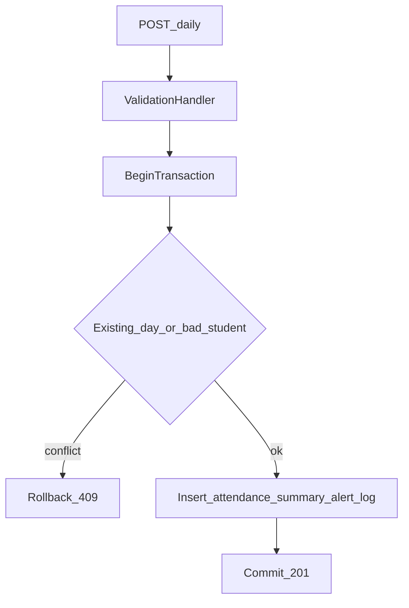

# Attendance Web API — Implementation Plan

.NET 8 monolith for daily attendance. This is the plan the new solution follows. The Legacy VB6 application and its SQL scripts stay untouched and are not referenced.

Business rules come from `Legacy/docs/legacy-analysis.md`. Index and table notes come from `Legacy/docs/legacy-analysis-enhancement.md`. Two legacy defects are fixed here: a school year is a September–August date range, and a duplicate day is rejected instead of updated.

The fallback chronic-absence count is `Attendance:ChronicAbsenceDays` in configuration (default 10), so it can change without a code change. A school that stores `AbsenceAlertThreshold` still uses that value.

## Layout

One web project, split by folder. Tests are separate projects.

- `AttendanceSystem.slnx`
- `src/AttendanceSystem.Api/` — `Controllers`, `Dtos`, `Services`, `Validation`, `Middleware`, `Infrastructure`, `Domain`
- `tests/AttendanceSystem.UnitTests/`
- `tests/AttendanceSystem.IntegrationTests/`

Stack: ASP.NET Core 8, EF Core 8 with SQLite, FluentValidation, xUnit, `WebApplicationFactory`. No MediatR. `Program.cs` only composes dependency injection, creates the schema, and seeds when the database is empty.

## Endpoints

- `POST /api/attendance/daily` — save one school-day for many students. `201` with the saved rows.
- `GET /api/attendance/students/{studentId}/history?schoolYear=` — daily history for that year, newest first. An omitted year uses the September rule on today.
- `GET /api/attendance/students/{studentId}/chronic-absenteeism?schoolYear=` — `totalAbsences`, the threshold that was applied, and `isChronicallyAbsent`.

Request and response types live only in `Dtos`. Controllers depend on `IAttendanceService`. The service depends on `IAttendanceStore` and `IUnitOfWork`, implemented with EF Core in `Infrastructure`.

## Save behavior

Validation runs first. The write then runs in one EF Core transaction. Any failure rolls the batch back, including attendance rows, the summary, the alert, and the submission log.

- The school must exist and be active. Each student must exist, be active, and belong to that school. Otherwise `404`.
- The code must exist and be active. `IsAbsent` and `IsExcused` are copied from the code onto the row. An unknown or inactive code is `400`.
- The same student twice in one request is `400`.
- If any student already has a row for that `AttendDate`, save nothing and return `409` with the conflicting student ids. The unique index is the backstop.
- Resolve one term whose dates cover `AttendDate` for that school. No term leaves `TermId` null. Overlaps use the lowest term id.
- School year: month >= 9 means `YYYY-(YYYY+1)`, otherwise `(YYYY-1)-YYYY`. Recount absences for that student, school, and date range only. Excused absences still count. Upsert `StudentAttendanceSummary` on `(StudentId, SchoolYear)` and refresh `SchoolId`.
- The threshold is `AbsenceAlertThreshold` when it is set, otherwise `Attendance:ChronicAbsenceDays`. If the total is at or above it and no unresolved `CHRONIC_ABSENCE` exists for that student and year, insert one alert.
- Write one `AttendanceSubmissionLog` row in the same transaction. `SubmittedBy` comes from the request, or `api` when it is blank.

History and chronic status read stored rows. Chronic status is `totalAbsences >= threshold`, not “an alert row exists”. A missing student is `404`. A student with no rows returns an empty history and a zero total. A `schoolYear` that is not `YYYY-YYYY` with the second year equal to the first plus one is `400`.

## Cross-cutting

- `IValidationHandler` runs the FluentValidation validator for the request and throws `ValidationFailedException`. Each service method calls it before work.
- `ExceptionHandlingMiddleware` maps validation to `400`, not found to `404`, conflict to `409`, and any other exception to `500`, all as problem details. The body has no stack trace.
- `AddAttendanceApplication` and `AddAttendanceInfrastructure` register validators, services, options, the SQLite `DbContext`, and the store. `Program.cs` calls both and adds the middleware.

## SQLite

EF Core creates the schema on startup with `EnsureCreated`. Indexes are composite SQLite indexes.

- Unique `(StudentId, AttendDate)` on attendance
- `(StudentId, SchoolId, AttendDate)` for the recount
- `(SchoolId, Active, Grade)` on students
- `(Active, SchoolName)` on schools
- `(SchoolId, StartDate, EndDate)` on terms
- `(StudentId, SchoolYear, AlertType)` on alerts
- Unique `(StudentId, SchoolYear)` on the summary
- Unique `AttendanceCodes.CodeValue`
- Foreign keys to schools, students, terms, and `CodeValue`, with delete restricted so absence flags are not cascaded

Seed, inserted only when the database has no schools:

- Codes `P` (present), `A` (absent), `E` (excused absent), `T` (tardy, not absent)
- Lincoln Elementary, active, threshold 10; Riverside High, active, threshold 5; Closed Academy, inactive, threshold 10
- Fall and spring terms for the two active schools covering `2025-2026` and `2026-2027`
- Active students in more than one grade and school, plus one inactive student and one student at the inactive school
- Grace Hopper has ten current-year absences at Lincoln, so she sits on the threshold, with one open chronic alert
- Katherine Johnson has two current-year absences at Riverside, below her threshold of 5
- Marie Curie has prior-year rows in May 2026
- Ada Lovelace has no attendance, so a save of a new date does not collide with seed data

Stable ids after that insert order: schools 1–3, students 1 Ada, 2 Alan Turing, 3 Grace Hopper, 4 Bob Inactive, 5 Katherine Johnson, 6 Marie Curie, 7 Helen Keller.

## Tests

Unit tests do not open HTTP or SQLite.

- School-year boundaries: 1 Sep 2026, 31 Aug 2026, 20 Oct 2026, and the September–August range
- Validators: empty batch, duplicate student in the payload, negative minutes, blank code, notes over 500 characters, bad school year
- Chronic calculation at, below, and above the threshold, including a null school threshold that uses the configured default of 10
- Save service with a fake store: school or student not found, inactive school or student, student in another school, duplicate day, unknown code, snapshot flags, summary count, alert inserted once, and a second save that does not insert another open alert

Integration tests use `WebApplicationFactory` and a temporary SQLite file per test.

- `201` save persists attendance, summary, and the submission log
- Present does not increase the absence total; excused absence does; tardy does not
- `409` when any student in the batch already has that date, and neither the new nor the other students in that request are written
- `400` for an empty batch, a repeated student, negative minutes, a blank code, an unknown code, and a bad school year
- `404` for an unknown student, an inactive student, an unknown school, an inactive school, and a student who belongs to another school
- History is limited to the requested year and ordered newest first; an unknown student is `404`; a student with no rows returns an empty list
- Chronic status is false below the threshold, true at the threshold, and `404` when the student does not exist
- A fault thrown after the writes and before commit returns `500` and leaves no attendance row and no submission log
- The SQLite catalog contains the indexes above, and the seed counts match this plan
